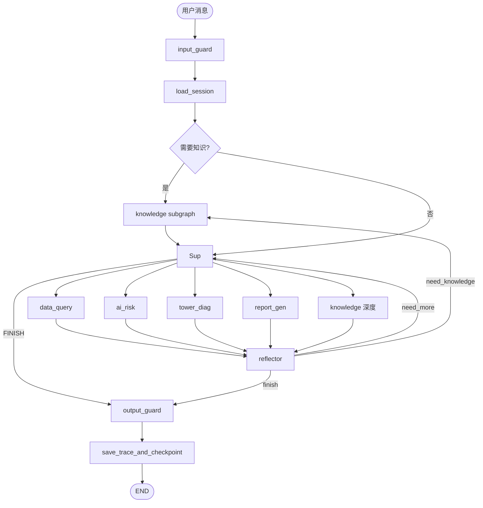

# 02 · 图设计

> 这是整个方案最核心的部分。任何 Graph 的节点、状态、条件边的修改都必须先在本设计文档讨论并更新。

## 顶层架构图

```
                          ┌─────────────────────┐
                          │  用户消息 (User)    │
                          └──────────┬──────────┘
                                     │
                                     ▼
                          ┌─────────────────────┐
                          │   input_guard       │
                          │   (输入护栏)        │
                          └──────────┬──────────┘
                                     │ passed
                                     ▼
                          ┌─────────────────────┐
                          │   load_session      │
                          │  (加载 checkpoint)  │
                          └──────────┬──────────┘
                                     │
                                     ▼
                          ╔═════════════════════╗
                          ║   KGCheck (cheap)   ║
                          ║   "需要查知识吗？"  ║
                          ╚════════╤══════╤═════╝
                              yes  │      │ no
                                   ▼      │
                       ┌────────────────┐ │
                       │   knowledge    │ │
                       │   subgraph     │ │
                       │   (Agentic     │ │
                       │    RAG)        │ │
                       └───────┬────────┘ │
                               │          │
                               └────┐     │
                                    ▼     ▼
                          ┌─────────────────────┐
                          │     Supervisor      │
                          │    (LLM 决策)       │
                          └──┬──┬──┬──┬──┬──────┘
                             │  │  │  │  │
                             │  │  │  │  └─────►[knowledge 深度检索]
              ┌──────────────┘  │  │  └────────►[report_gen  日报]
              │  ┌──────────────┘  └───────────►[tower_diag 塔吊诊断]
              │  │  ┌──────────────────────────►[ai_risk    AI 风险]
              │  │  │
              ▼  ▼  ▼
        ┌──────────┐  ┌──────────┐  ┌──────────┐
        │ data_    │  │ tower_   │  │ report_  │
        │ query    │  │ diag     │  │ gen      │
        └────┬─────┘  └────┬─────┘  └────┬─────┘
             │             │             │
             └──────┬──────┴──────┬──────┘
                    │             │
                    └──────┬──────┘
                           ▼
                  ┌────────────────┐
                  │   reflector    │
                  │   (反思节点)   │
                  └────────┬───────┘
                           │
              ┏━━━━━━━━━━━━┻━━━━━━━━━━━━┓
              ▼            ▼             ▼
        need_more    need_knowledge   finish
              │            │             │
              ▼            ▼             ▼
       ┌──────────┐  ┌──────────┐  ┌──────────────┐
       │  back to │  │ knowledge│  │ output_guard │
       │ Supervisor│  │ subgraph │  │ (输出护栏)   │
       └────┬─────┘  └────┬─────┘  └──────┬───────┘
            │             │               │
            └─────────────┘               │ passed
                                          ▼
                                 ┌─────────────────┐
                                 │ save_trace &    │
                                 │ checkpoint      │
                                 │ (双写 Redis+    │
                                 │  MySQL)         │
                                 └────────┬────────┘
                                          │
                                          ▼
                                        [END]
```

**Mermaid 等价**：


## AgentState 详细定义

```python
from typing import TypedDict, Annotated, Sequence, Literal, Optional
from langgraph.graph.message import add_messages
from langchain_core.messages import BaseMessage
from datetime import datetime

class SubgraphResult(TypedDict):
    summary: str
    data: dict
    citations: list[str]
    confidence: float

class PendingAction(TypedDict):
    action_type: str
    args: dict
    reason: str
    risk_level: Literal["low", "medium", "high"]

class HumanDecision(TypedDict):
    approved: bool
    comment: Optional[str]

class GuardResult(TypedDict):
    passed: bool
    reason: Optional[str]
    details: dict

class TraceSpan(TypedDict):
    span_id: str
    parent_span_id: Optional[str]
    name: str
    started_at: datetime
    finished_at: Optional[datetime]
    status: Literal["running", "ok", "error"]
    input: Optional[dict]
    output: Optional[dict]
    error: Optional[str]
    tokens_in: int
    tokens_out: int
    metadata: dict

class AgentState(TypedDict):
    # 对话
    messages: Annotated[Sequence[BaseMessage], add_messages]

    # 身份
    user_id: int
    thread_id: str
    session_id: str

    # 路由
    next_agent: Literal["data_query", "ai_risk", "tower_diag",
                        "report_gen", "knowledge", "FINISH", "ERROR"]
    previous_agents: list[str]

    # 草稿本
    scratchpad: dict[str, SubgraphResult]

    # RAG 缓存
    retrieved_docs: list[dict]
    retrieval_query_history: list[str]

    # 护栏
    input_guard: GuardResult
    output_guard: GuardResult
    loop_guard: GuardResult

    # 资源
    iteration_count: int
    subgraph_iteration: dict[str, int]
    total_tokens_in: int
    total_tokens_out: int
    started_at: datetime
    deadline_at: datetime

    # HITL
    pending_action: Optional[PendingAction]
    human_decision: Optional[HumanDecision]

    # 追踪
    trace_id: str
    current_span_id: str
    span_stack: list[TraceSpan]

    # 错误
    error: Optional[str]
    error_node: Optional[str]
```

## 顶层节点规格

| 节点 | 输入 | State 更新 | 关键逻辑 |
|------|------|-----------|---------|
| `input_guard` | `messages[-1]` | `input_guard` | 长度、注入检测、PII 脱敏、速率限制 |
| `load_session` | `thread_id` | `scratchpad`, `previous_agents` | Redis → miss 时 MySQL → rehydrate |
| `KGCheck` | `messages[-1]` | `next_agent` | 轻量 LLM 判断"要不要先查知识" |
| `supervisor` | `messages`, `scratchpad` | `next_agent` | LLM 决策 + JSON schema 强制；触发"目标模糊"冲突仲裁时先 `interrupt` |
| `reflector` | `messages`, `scratchpad` | `next_agent` | 评估信息充分性 + 反循环检测 |
| `output_guard` | `messages[-1]` | `output_guard` | 长度、引用校验、敏感数据脱敏 |
| `save_trace_and_checkpoint` | 全 state | 无 | 异步双写 Redis + MySQL |

**Supervisor 中的"目标模糊"冲突仲裁**（P4 落地）：

当用户请求涉及"报告"类生成但未指定类型/时间窗口时，Supervisor 在调 LLM 决策之前先用纯规则检测是否歧义，命中则 `interrupt` 让用户选：

```python
# app/graph/supervisor.py
REPORT_GEN_TRIGGERS = ["报告", "报表", "日报", "周报", "月报", "专题", "汇总", "rpt"]
REPORT_TYPE_KEYWORDS = ["日报", "周报", "月报", "季报", "年报", "专题", "异常"]
TIME_RANGE_PATTERN = re.compile(
    r"\d{4}-\d{2}-\d{2}|今天|昨天|明天|本周|上周|下周|本月|上月|最近\d+[天周月]"
)

def detect_report_type_ambiguity(msg: str) -> bool:
    has_trigger = any(kw in msg for kw in REPORT_GEN_TRIGGERS)
    has_type = any(t in msg for t in REPORT_TYPE_KEYWORDS)
    has_time = bool(TIME_RANGE_PATTERN.search(msg))
    return has_trigger and not has_type and not has_time

def supervisor_node(state):
    user_msg = state["messages"][-1].content
    if detect_report_type_ambiguity(user_msg):
        decision = interrupt({
            "type": "conflict_resolution_required",
            "source": "target_ambiguous",
            "context": f"用户请求 '{user_msg}' 未指定报告类型或时间范围",
            "options": [
                {"id": "daily",  "label": "今日日报",  "next_agent": "report_gen",
                 "args": {"report_type": "daily", "date": today()}},
                {"id": "weekly", "label": "本周周报",  "next_agent": "report_gen",
                 "args": {"report_type": "weekly", "date_range": this_week()}},
                {"id": "incident", "label": "异常专题", "next_agent": "report_gen",
                 "args": {"report_type": "incident", "incident_id": None}},
            ],
            "allow_custom": True,  # 用户可输入自定义需求
        })
        # 把用户选择合并到 messages，让 LLM 看到具体类型
        return Command(goto="llm_decide", update={
            "messages": [HumanMessage(content=(
                f"用户最终意图: {decision.get('custom') or decision['selected']}"
            ))],
            "scratchpad": {**state["scratchpad"], "_user_report_choice": decision},
        })
    return llm_decide(state)
```

**为什么不直接让 LLM 决策**：LLM 面对"出份报告"会自己猜，命中率约 60-70%，让用户先选一次能提升到 95%+，且对用户来说成本极低（点一下）。规则检测本身免费、不增加 LLM 调用。

### Supervisor prompt 关键约束

```
你是 Supervisor。基于用户消息和已收集信息，决定下一步：
1. 路由到哪个 sub-agent（data_query / ai_risk / tower_diag / report_gen / knowledge）
2. 如果已收集��足够信息，回答 FINISH
3. 如果已超过 8 次迭代仍无结论，回答 ERROR
4. 必须以 JSON 输出：{"next": "...", "reason": "...", "plan": "..."}

可用 sub-agent 能力：
- data_query: 查设备/监测点/报警/环境数据
- ai_risk: 分析 AI 摄像头报警 + 提供处置建议（含写操作 HITL）
- tower_diag: 塔吊时序数据 + LSTM 预测 + 诊断
- report_gen: 自动汇总生成日报
- knowledge: 概念/阈值/API 用法的知识检索
```

### Reflector prompt 关键约束

```
你是反思节点。评估 sub-agent 刚刚返回的结果：
1. 信息是否充分回答用户问题？
2. 是否需要回 Supervisor 路由到另一个 agent？
3. 是否陷入了循环（同一类问题被查询 2 次以上）？
4. 必须以 JSON 输出：{"action": "continue" | "back_to_supervisor" | "finish", "reason": "..."}
```

---

## 1. data_query 子图

```
        ┌────────────────────┐
        │  enter_subgraph    │   注入上下文 + 计数+1
        └─────────┬──────────┘
                  │
                  ▼
        ┌────────────────────┐
        │   agent_node       │   LLM 决策（读工具 / 退出）
        └────┬───────────────┘
             │
             │ 无工具调用
             ▼
        ┌────────────────────┐
        │   exit_subgraph    │   封装 SubgraphResult
        └─────────┬──────────┘
                  │
                  │ 有工具调用
                  ▼
        ┌────────────────────┐
        │    tool_node       │   并发执行工具
        └─────────┬──────────┘
                  │
                  ▼
        ┌────────────────────┐
        │   loop_guard       │   检查迭代/token/循环
        └────┬───────────────┘
             │
        ┌────┴────┐
        │ ok      │ violated
        ▼         ▼
   (回 agent)  error_exit
```

**关键工具**：
- `query_equipment_list` (POST `/equipmentAssets/list`)
- `query_monitor_points` (POST `/equipmentMonitorPoint/list`)
- `query_recent_alerts` (POST `/monitorPointAlert/selectPage`)
- `query_env_values` (POST `/environmentValue/list` + `getEnvironmentInfo`)
- `get_dashboard_summary` (POST `/dashboard/getDashboardData`)
- `knowledge_search`（共享工具，自动可用）

**约束**：同一工具连续调用不超过 2 次（防循环）。

---

## 2. ai_risk 子图（含 HITL）

```
                ┌────────────────────┐
                │  enter_subgraph    │
                └─────────┬──────────┘
                          │
                          ▼
                ┌────────────────────┐
                │   agent_node       │
                │   (LLM 决策)       │
                └──┬─────────────┬───┘
                   │             │
              读工具│             │ 写工具
                   ▼             ▼
            ┌──────────────┐  ┌──────────────┐
            │  tool_node   │  │  hitl_check  │
            │  (并发执行)  │  │  (风险分级)  │
            └──────┬───────┘  └──────┬───────┘
                   │                 │
                   │         ┌───────┼───────┐
                   │         │ low  │ medium │ high
                   │         ▼      ▼        ▼
                   │    auto-approved  interrupt
                   │         │      │        │
                   │         │      ▼        │
                   │         │  [等用户]      │
                   │         │      │        │
                   │         │      ▼        │
                   │         │  apply_decision
                   │         │      │        │
                   │         │   ┌──┴──┐     │
                   │         │ approved?     │
                   │         │  │    │      │
                   │         │ yes  no      │
                   │         │  │    ▼      │
                   │         │  │ denied_feedback
                   │         │  │    │      │
                   │         └──┼────┼──────┘
                   │            │    │
                   ▼            ▼    ▼
                ┌────────────────────┐
                │   loop_guard       │
                │  (检查迭代/循环)   │
                └─────────┬──────────┘
                          │
                          ▼
                  (回到 agent_node)
```

**HITL 风险分级**：
- `low`：只读操作（默认 auto-approved）
- `medium`：修改单条记录状态（need human）
- `high`：批量操作/删除（need human + 二次确认）

**interrupt 实现**：
```python
from langgraph.types import interrupt, Command

async def hitl_check_node(state) -> Command:
    pending = state["pending_action"]
    if pending["risk_level"] == "low":
        return Command(goto="tool_node")

    human_decision = interrupt({
        "type": "human_confirm_required",
        "action": pending,
    })
    return Command(
        goto="apply_decision",
        update={"human_decision": human_decision}
    )
```

---

## 3. tower_diag 子图

```
                ┌────────────────────┐
                │  enter_subgraph    │
                └─────────┬──────────┘
                          │
                          ▼
                ┌────────────────────┐
                │   plan_diag        │
                │  (LLM 规划诊断步骤)│
                └─────────┬──────────┘
                          │
                          ▼
                ┌────────────────────┐
                │   collect_data     │
                │ (并发调 get_tower_ │
                │  data + alarm_info)│
                └─────────┬──────────┘
                          │
                          ▼
                    ╔═══════════╗
                    ║ 需要预测? ║
                    ╚═════╤═════╝
                      是  │   否
                          ▼   ▼
                ┌────────────────┐
                │ predict_tower_ │
                │ safety (LSTM)  │
                │ 调 AIRecognize │
                │  /crane_safety │
                └────────┬───────┘
                         │
                         ▼
                ┌────────────────────┐
                │   analyze_node     │
                │  (LLM 综合分析)    │
                └─────────┬──────────┘
                          │
                  ┌───────┼───────┐
                  ▼       ▼       ▼
              need more            done
                  │                 │
                  └────►collect_data │
                                    ▼
                            ┌──────────────┐
                            │ exit_subgraph│
                            └──────┬───────┘
                                   │
                                   ▼
                            (回到 Supervisor)
```

**关键工具**：
- `list_tower_assets` (POST `/tower/selectAllTower`)
- `get_tower_data` (POST `/tower/getData/{assetId}`)
- `get_tower_alarm_info` (POST `/tower/getTowerAlarmInfo/{assetId}`)
- `get_tower_work_info` (POST `/tower/getTowerWorkInfo/{assetId}`)
- `predict_tower_safety` (POST `http://localhost:5000/crane_safety`)
- `knowledge_search`（共享工具，查"塔吊倾角阈值含义"等概念问题）

---

## 4. report_gen 子图（编排其他工具）

```
                ┌────────────────────┐
                │  enter_subgraph    │
                └─────────┬──────────┘
                          │
                          ▼
                ┌────────────────────┐
                │  report_planner    │
                │  (LLM 规划大纲)    │
                └─────────┬──────────┘
                          │
                          ▼
                  ╔════════════════╗
                  ║  并行 dispatch  ║
                  ╚════════╤═══════╝
                           │
        ┌────────────┬─────┼─────┬────────────┐
        ▼            ▼     ▼     ▼            ▼
   ┌─────────┐ ┌─────────┐ ┌───���─────┐ ┌─────────┐ ┌─────────┐
   │ query   │ │ query   │ │ query   │ │ query   │ │knowledge│
   │ 今日报警│ │ 设备状态│ │ 环境数据│ │ AI 报警 │ │_search │
   └────┬────┘ └────┬────┘ └────┬────┘ └────┬────┘ └────┬────┘
        │           │           │           │           │
        └───────────┴─────┬─────┴───────────┴───────────┘
                          │
                          ▼
                ┌────────────────────┐
                │   report_writer    │
                │   (LLM 撰写日报)   │
                └─────────┬──────────┘
                          │
                          ▼
                ┌────────────────────┐
                │  citation_check    │
                │  (引用校验)        │
                └─────────┬──────────┘
                          │
                  ┌───────┼───────┐
                  ▼               ▼
              missing              ok
                  │               │
                  ▼               ▼
           (back to         ┌──────────────┐
            dispatch)       │ exit_subgraph│
                            └──────┬───────┘
                                   │
                                   ▼
                            (回到 Supervisor)
```

---

## 5. knowledge 子图（Agentic RAG）

```
                        ┌────────────────────┐
                        │  enter_subgraph    │  设置预算/计数
                        └─────────┬─────────��┘
                                  │
                                  ▼
                        ┌────────────────────┐
                        │  query_rewriter    │  LLM 重写查询
                        └─────────┬──────────┘
                                  │
                                  ▼
                        ┌────────────────────┐
                        │  hybrid_search     │  BM25 + Dense + RRF
                        └─────────┬──────────┘
                                  │
                                  ▼
                        ┌────────────────────┐
                        │  reranker          │  Cohere / bge
                        │  top-20 → top-5    │
                        └─────────┬──────────┘
                                  │
                                  ▼
                           ╔══════════════╗
                           ║   critic     ║  LLM 评分
                           ║ rel+ground   ║  rel&ground ≥ 0.5 通过
                           ╚══════╤═══════╝
                                  │
                    ┌─────────────┼─────────────┐
                    │ score<0.5   │             │ score≥0.5
                    │ +retries<2  │             │
                    ▼             │             ▼
            ┌──────────────┐      │     ┌──────────────┐
            │ query_refiner│      │     │  composer    │  LLM 写作
            └──────┬───────┘      │     └──────┬───────┘
                   │              │            │
                   │ retries≥2    │            ▼
                   ▼              │     ┌──────────────┐
            ┌──────────────┐      │     │ citation_    │  引用校验
            │ empty_answer │      │     │ check        │
            │(明示无知识)  │      │     └──────┬───────┘
            └──────┬───────┘      │            │
                   │              │            │ missing
                   │              │            ▼
                   │              │     ┌──────────────┐
                   │              │     │ back to      │
                   │              │     │ query_refiner│
                   │              │     └──────┬───────┘
                   │              │            │ ok
                   │              │            │
                   ▼              ▼            ▼
                        ┌────────────────────┐
                        │   exit_subgraph    │
                        └─────────┬──────────┘
                                  │
                                  ▼
                            (回到 Supervisor)
```

| 节点 | 实现 | 关键参数 |
|------|------|---------|
| `query_rewriter` | LLM | 把口语化查询改写为多关键词组合；可生成 3 个查询变体 |
| `hybrid_search` | ChromaDB + 自建 BM25 | top-k=20；并行召回；RRF 融合（k=60） |
| `reranker` | Cohere Rerank 3.5（或 bge-reranker-v2-m3） | 取 top-5 |
| `critic` | LLM with structured output | 评分 {relevance, grounding}，任一 <0.5 重写；连续 2 次仍 <0.5 时 `interrupt` 让用户选 |
| `conflict_detect` | LLM | 检测 top-5 chunks 中"对同一事实的不同说辞"；有冲突时 `interrupt` 让用户仲裁 |
| `composer` | LLM | 基于 top-5 片段生成回答；每句话必须标注 `[doc_id]` |
| `citation_check` | 规则 | 答案中所有事实断言对应 doc_id 必须存在于 retrieved_docs |

#### knowledge 子图中的"冲突仲裁"（P6 落地）

P6 在 `critic` 之后、`composer` 之前增加 `conflict_detect` 节点。**两处**会触发 `interrupt`：

**触发点 1：critic 评分持续低（refine 已用完 retry 额度）**

```python
# app/graph/subgraphs/knowledge.py
def critic_node(state) -> Command:
    score = llm_score(state["query"], state["chunks"])
    state["critic_score"] = score
    state["refine_retries"] += 1

    if score >= 0.5:
        return Command(goto="conflict_detect")
    if state["refine_retries"] < 2:
        return Command(goto="refine")

    # 2 次重查仍不达标 → 让用户选
    chunks = state["chunks"]
    if not chunks:
        options = [
            {"id": "try_other_kb",   "label": "尝试外部搜索", "description": "超出本系统知识范围"},
            {"id": "general_answer", "label": "用通用知识回答", "description": "不保证准确性"},
            {"id": "escalate_human", "label": "转给运维补充", "description": "记入待办"},
            {"id": "give_up",        "label": "放弃这个问题"},
        ]
    else:
        options = [
            {"id": f"chunk_{i}",
             "label": f"片段 {i+1}（相关度 {c['score']:.2f}）",
             "description": c["content"][:120] + "...",
             "selected_chunk": c}
            for i, c in enumerate(chunks[:5])
        ] + [{"id": "general_answer", "label": "用通用知识回答"}]

    decision = interrupt({
        "type": "conflict_resolution_required",
        "source": "low_confidence",
        "context": f"已重查 2 次仍未找到「{state['query']}」的可靠答案",
        "options": options,
    })
    return Command(goto="apply_conflict_decision",
                   update={"_low_confidence_decision": decision})
```

**触发点 2：检索到说辞冲突的 chunks**

```python
CONFLICT_DETECT_PROMPT = """分析以下检索片段，找出"对同一事实给出不同说辞"的冲突。

片段：
{chunks}

输出 JSON：
{{
  "conflicts": [
    {{
      "topic": "冲突主题",
      "claims": [
        {{"value": "具体说法", "doc_id": "来源", "source": "文件名"}}
      ]
    }}
  ]
}}

若无冲突，输出 {{"conflicts": []}}"""

def conflict_detect_node(state) -> Command:
    conflicts = llm_detect_conflicts(state["chunks"])  # ~500 tokens

    if not conflicts:
        return Command(goto="composer")

    # 单条冲突 → 展示具体冲突让用户选
    if len(conflicts) == 1:
        c = conflicts[0]
        options = [
            {"id": f"claim_{i}", "label": f"采用: {cl['value']}",
             "description": f"来源: {cl['source']} ({cl['doc_id']})",
             "selected_chunk": cl}
            for i, cl in enumerate(c["claims"])
        ] + [
            {"id": "show_both", "label": "两种说法都呈现"},
            {"id": "skip",      "label": "跳过这个问题"},
        ]
        decision = interrupt({
            "type": "conflict_resolution_required",
            "source": "multi_source_conflict",
            "context": f"关于「{c['topic']}」，不同文档有不同说辞",
            "options": options,
        })
        return Command(goto="apply_conflict_decision",
                       update={"_conflict_decisions": [decision]})

    # 多条冲突 → 让用户选全局策略
    decision = interrupt({
        "type": "conflict_resolution_required",
        "source": "multi_source_conflict",
        "context": f"检索到 {len(conflicts)} 处文档说辞冲突",
        "options": [
            {"id": "newest",         "label": "采用最新文档",  "description": "按文档修改时间"},
            {"id": "highest_score",  "label": "采用相关度最高", "description": "按 Reranker 分数"},
            {"id": "show_all",       "label": "答案中并列展示", "description": "用户自己看"},
            {"id": "human_judge",    "label": "暂停，我去查证", "description": "进入人工暂停"},
        ],
    })
    return Command(goto="apply_conflict_decision",
                   update={"_conflict_strategy": decision})

def apply_conflict_decision_node(state) -> Command:
    """根据用户决策过滤 / 改写 chunks，再交给 composer"""
    decision = state.get("_conflict_decisions", [{}])[0]
    strategy = state.get("_conflict_strategy")

    if strategy and strategy.get("selected") == "newest":
        state["chunks"] = sorted(
            state["chunks"],
            key=lambda c: c["metadata"].get("updated_at", ""),
            reverse=True,
        )
    elif strategy and strategy.get("selected") == "highest_score":
        state["chunks"] = sorted(state["chunks"], key=lambda c: c["score"], reverse=True)

    if decision.get("selected_chunk"):
        # 用户指定了采用某条 claim → 把这条 claim 注入到 chunks 顶部
        state["chunks"] = [decision["selected_chunk"]] + state["chunks"]

    return Command(goto="composer")
```

**更新后的 knowledge 子图节点序列**：
```
query_rewriter → hybrid_search → reranker → critic
    ↓ (score<0.5, retries<2)
refine ──┐
    ↓ (score<0.5, retries≥2) → interrupt(low_confidence) → apply_conflict_decision
    ↓ (score≥0.5)
conflict_detect
    ↓ (no conflict)
    ↓ (conflicts=1)        → interrupt(multi_source_conflict) → apply_conflict_decision
    ↓ (conflicts>1)        → interrupt(multi_source_conflict, 策略选择) → apply_conflict_decision
composer → citation_check → exit_subgraph
```

**SubgraphResult 结构**：
```python
{
    "summary": "塔吊安全预测模型基于...",
    "data": {
        "answer": "...",
        "citations": ["doc_abc#chunk_3", "doc_xyz#chunk_7"],
        "support_score": 0.87
    },
    "citations": ["docs/塔吊安全预测/模型说明.md"],
    "confidence": 0.87
}
```

---

## 输出事件协议（SSE 推送给前端）

```
event: trace
data: {"type":"node_start","name":"supervisor","span_id":"..."}

event: trace
data: {"type":"llm_call","model":"gpt-4o","tokens_in":234}

event: trace
data: {"type":"route","next":"data_query","reason":"用户要查数据"}

event: trace
data: {"type":"tool_call","name":"query_recent_alerts","args":{...}}

event: trace
data: {"type":"tool_result","name":"query_recent_alerts","latency_ms":312}

event: trace
data: {"type":"agent_start","agent":"data_query"}

event: token
data: "经查询，今日塔吊"

event: token
data: "共发生 3 条报警..."

event: trace
data: {"type":"retrieval","query":"塔吊倾角阈值","hits":5,"top_score":0.89}

event: trace
data: {"type":"reflection","action":"finish","reason":"信息充分"}

event: human_confirm_required
data: {"action":{"action_type":"mark_ai_alert_handled","args":{...}}}

event: conflict_resolution_required
data: {"source":"target_ambiguous|multi_source_conflict|low_confidence",
      "context":"...",
      "options":[{"id":"...","label":"...","description":"..."}]}

event: token
data: "已为您标记该报警为已处理"

event: done
data: {"answer":"...","trace_id":"...","tokens":1234}
```

**新增 `conflict_resolution_required` 事件**（与 `human_confirm_required` 平级）：
- `source`：`target_ambiguous` / `multi_source_conflict` / `low_confidence`
- `context`：当前情况说明（前端展示在弹窗标题）
- `options`：候选答案列表，每项含 `id` / `label` / `description` / 可选 `selected_chunk`
- 前端弹 `ConflictResolutionDialog.vue`（独立组件），用户提交后调 `/agent/chat/resume` 携带 `decision`
- 同一套 `interrupt()` 机制 + 同一套 `/chat/resume` 端点复用
- 详见 [04-稳定性与可观测性.md §4.7](./04-稳定性与可观测性.md)

## 子图统一构造器

```python
# app/graph/subgraphs/base.py
def build_subgraph(name: str, state_class, tools: list, system_prompt: str):
    """统一子图工厂，确保所有子图行为一致"""
    llm = get_llm().bind_tools(tools)

    def agent_node(state):
        msgs = [SystemMessage(content=system_prompt)] + list(state["messages"])
        return {"messages": [llm.invoke(msgs)]}

    def should_continue(state):
        last = state["messages"][-1]
        return "tools" if last.tool_calls else "exit"

    g = StateGraph(state_class)
    g.add_node("agent", agent_node)
    g.add_node("tools", ToolNode(tools))
    g.add_node("loop_guard", make_loop_guard(name))
    g.add_node("exit", make_subgraph_exit(name))

    g.set_entry_point("agent")
    g.add_conditional_edges("agent", should_continue, {"tools": "tools", "exit": "exit"})
    g.add_edge("tools", "loop_guard")
    g.add_edge("loop_guard", "agent")
    g.add_edge("exit", END)

    return g.compile()
```
