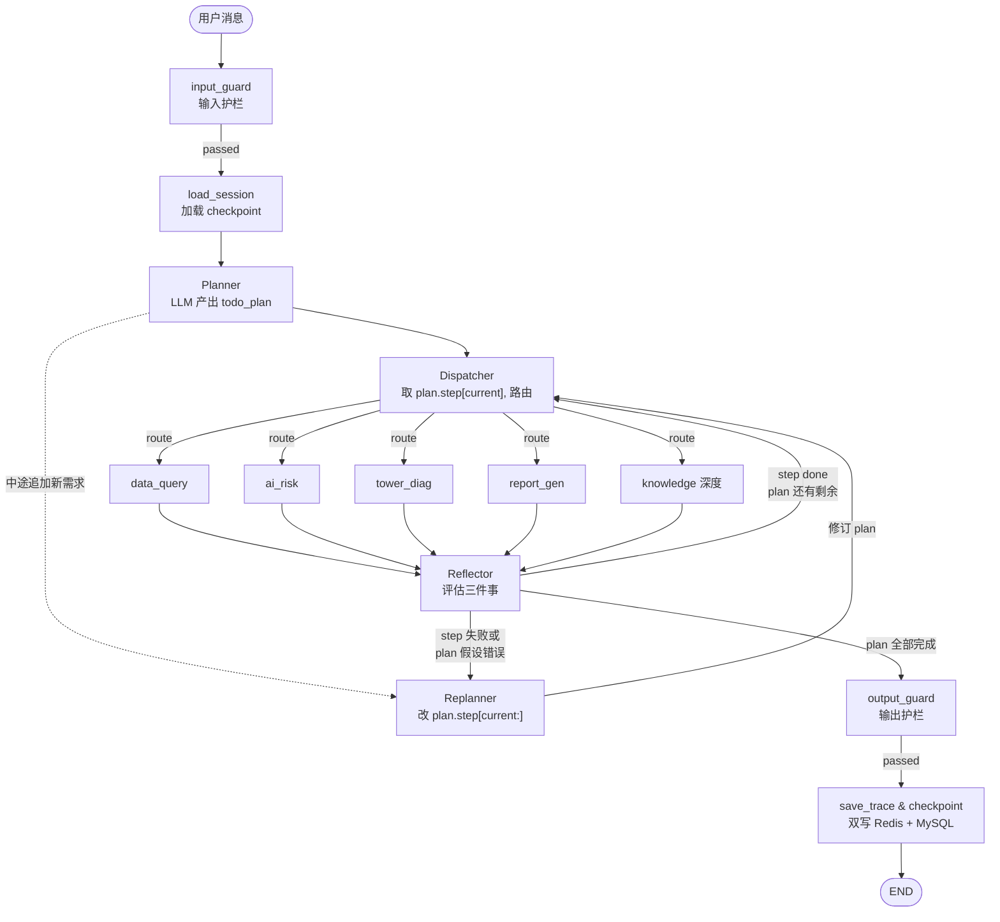
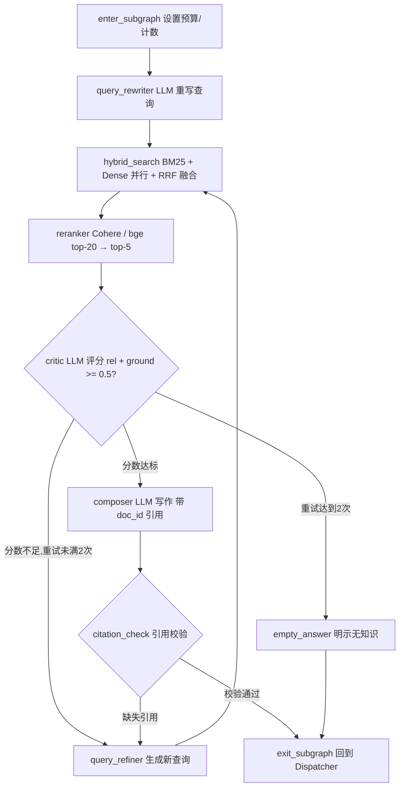
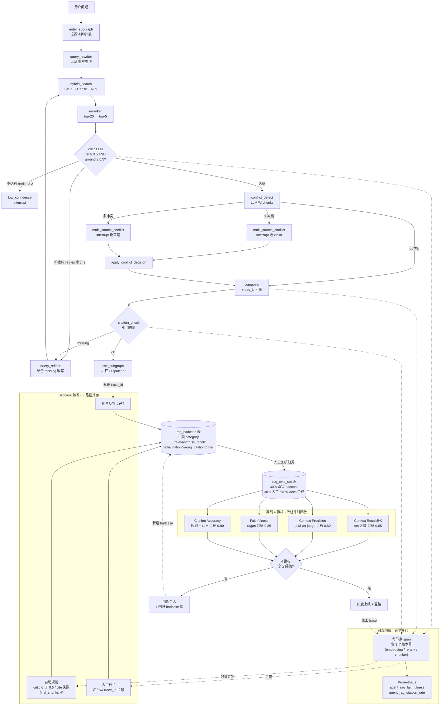
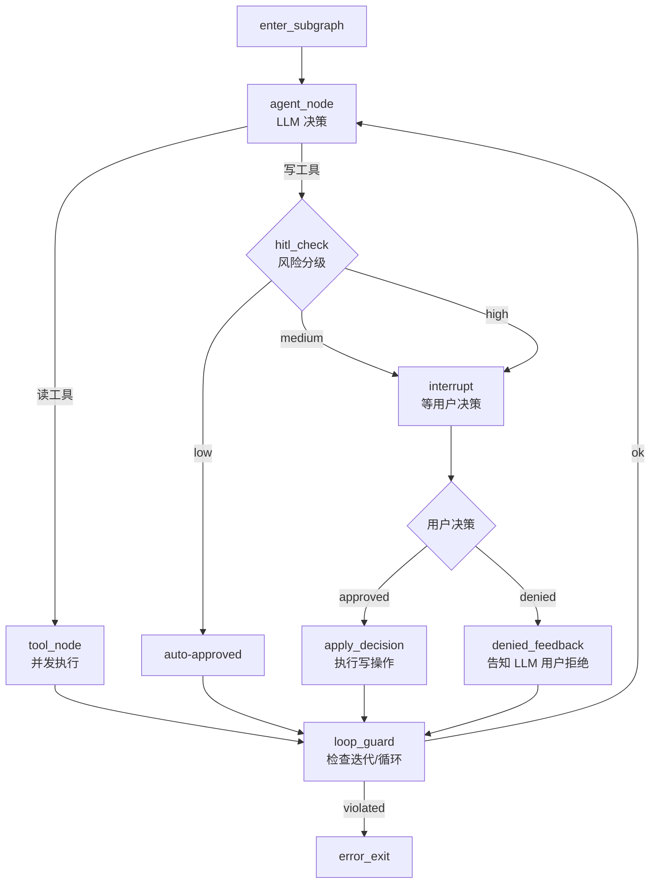
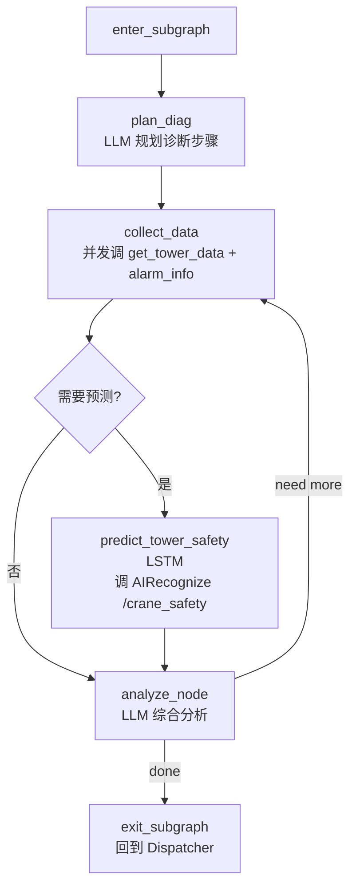
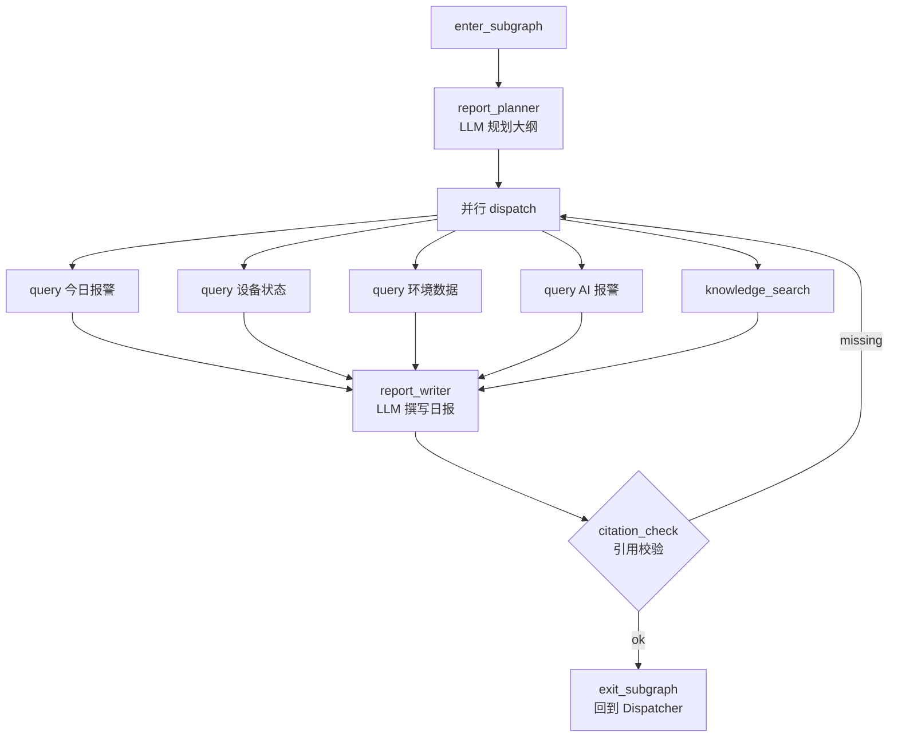
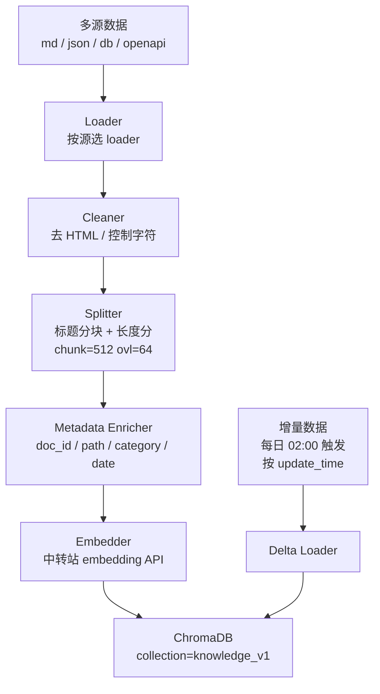

# LangGraph 1.0 多 Agent + Agentic RAG 接入智慧工地安全监测系统

> 📌 **本计划所有架构图均使用 Mermaid 绘制**，可在 VSCode（装 Mermaid 插件）、Typora、GitHub、GitLab 等平台渲染。
> 在纯文本编辑器中可看到 Mermaid 源码块，可复制到 https://mermaid.live 预览。

---

## Context

`building-safety-monitor` 当前用 Coze 作为「智能监测助手」后端（`CozeConversationController` + 前端 `DailyReportAssistant.vue`）。三个痛点：(1) 工具调用受限，无法直接查后端业务数据；(2) 平台知识/插件不能本地化，难调试与审计；(3) SSE 在后端被合并为单次响应，前端无流式体验。

改造目标：用 **LangGraph 1.0 多 Agent + Agentic RAG** 替代 Coze。新建独立 Python 微服务 `agent-service`（FastAPI + LangGraph 1.0），通过 HTTP 复用现有 Spring Boot REST 作为工具集；采用 **Plan-and-Execute**（Planner + Dispatcher + 5 个子 Agent：Data Query / AI Risk / Tower Diag / Report Gen / Knowledge）+ Reflector + Replanner 反思闭环 + Guardrails + Trace/Time-Travel 的生产级方案；输出真正 SSE 流式 + 中间过程事件。

## 关键决策（最终）

| 维度 | 决策 |
|------|------|
| 场景 | 多 Agent 协同（Planner + Dispatcher + 5 子 Agent，Plan-and-Execute） |
| 部署 | 独立 Python 微服务 `agent-service/` |
| **LangGraph 版本** | **1.0+（2025-12-12 GA，自带 durable execution）** |
| LLM | 中转站 OpenAI 兼容 API |
| **RAG** | **Agentic RAG（knowledge 子 Agent + 共享 retrieval 工具）** |
| 向量库 | **ChromaDB（开发）→ Qdrant（生产可平滑替换）** |
| Embedding | 中转站 embedding 接口（OpenAI 兼容 `text-embedding-3-small` 或同类） |
| 混合检索 | BM25 + Dense + Reranker |
| Checkpoint | Redis 主存 + MySQL 持久化（双层） |
| 工具后端 | 通过 Spring Boot API 转发 |
| 输出 | SSE 流式 + 中间过程事件 |
| Coze 关系 | 替代 `CozeConversationController` |
| 稳定性 | Trace + Time-Travel + Guardrails 全栈 |

## LangGraph 1.0 关键变化

参考 [LangGraph v1.0 Migration Guide](https://medium.com/@qasimwani618/langgraph-v1-0-migrating-from-0-x-to-1-0-c7a1faf6408d)：

| 项 | 0.x | 1.0 |
|----|-----|-----|
| Durable execution | 需显式 checkpointer | **默认开启**（`Pregel` 自动 checkpoint） |
| HITL `interrupt` | 实验性 | **GA** |
| Checkpointer | Postgres/SQLite/Redis | 同，**MySQL 仍需自实现** |
| LangSmith 集成 | 实验 | GA |

**依赖锁定**：
```toml
[tool.poetry.dependencies]
langgraph = "^1.0.0"
langgraph-checkpoint-redis = "^1.0.0"
langchain-openai = "^0.3.0"
langchain-core = "^0.3.0"
langchain-text-splitters = "^0.3.0"
chromadb = "^0.5.0"
cohere = "^5.0.0"
```

---

## 一、图设计（核心章节）

### 1.1 顶层架构图



**三层闭环说明**：

| 层级 | 节点 | 职责 |
|------|------|------|
| **规划层** | `Planner` | 收到用户消息后，一次性产出有序的 `todo_plan`（JSON schema 强约束），含步骤依赖与可验证的 `expected_output` |
| **执行层** | `Dispatcher` + 5 个子 Agent | 不再"边走边想"；从 plan 中取出当前 step，按 `target_agent` 调用；执行结果写入 `scratchpad` |
| **反思层** | `Reflector` + `Replanner` | Reflector 评估 step 是否完成 / plan 是否有效；失败或假设错误时触发 Replanner，仅修订 current 及后续步骤 |

相比原 Supervisor 模式：
- **解决跑偏**：plan 是全局目标，所有 step 围绕 plan 推进，Reflector 三判断避免走一步想一步
- **解决长任务**：复杂任务可一次性分解为 3-8 步，子图自治 + Replanner 按需修订
- **Time-Travel 友好**：每次 Replan 写一份 `plan_history`，可回放到任一 plan 版本

### 1.2 State 详细定义

```python
class AgentState(TypedDict):
    # 对话
    messages: Annotated[Sequence[BaseMessage], add_messages]

    # 身份
    user_id: int
    thread_id: str
    session_id: str

    # 路由（Plan-and-Execute 模式：next_agent 改为派生量，由 Dispatcher 从 current step 写入）
    next_agent: Optional[Literal["data_query", "ai_risk", "tower_diag",
                                  "report_gen", "knowledge", "FINISH", "ERROR"]]
    previous_agents: list[str]

    # Plan-and-Execute 核心
    todo_plan: list[PlanStep]              # 当前 plan；Replanner 触发时整体替换
    plan_version: int                      # Planner/Replanner 每次输出自增；Time-Travel 用
    current_step_id: Optional[int]         # 当前正在执行的 step
    plan_history: list[dict]               # 历史 plan 版本快照 [{version, plan, reason}]

    # 草稿本
    scratchpad: dict[str, SubgraphResult]

    # RAG 缓存
    retrieved_docs: list[dict]
    retrieval_query_history: list[str]

    # 护栏
    input_guard: GuardResult
    output_guard: GuardResult
    loop_guard: GuardResult

    # 资源
    iteration_count: int
    subgraph_iteration: dict[str, int]
    total_tokens_in: int
    total_tokens_out: int
    started_at: datetime
    deadline_at: datetime

    # HITL
    pending_action: Optional[PendingAction]
    human_decision: Optional[HumanDecision]

    # 追踪
    trace_id: str
    current_span_id: str
    span_stack: list[TraceSpan]

    # 错误
    error: Optional[str]
    error_node: Optional[str]
```

**PlanStep 类型定义**（AgentState.todo_plan 的元素）：

```python
class PlanStep(TypedDict):
    step_id: int                            # 步骤编号，唯一
    description: str                        # 人类可读的步骤说明
    target_agent: Literal["data_query", "ai_risk",
                          "tower_diag", "report_gen", "knowledge"]
    status: Literal["pending", "running", "done", "failed", "skipped"]
    dependencies: list[int]                  # 依赖的 step_id；为空则可立即执行
    expected_output: str                    # Reflector 评判依据（可验证的输出描述）
    actual_output: Optional[dict]           # 子图返回结果（done 后写入）
    retry_count: int                        # 已重试次数（Replanner 用）
```

**Plan 字段语义约束**：
- `step_id` 从 1 开始递增；Replanner 修改时**不得重排已有 done 的 step_id**
- `dependencies=[]` 的 step 可立即执行；否则需等待所有依赖 step 状态为 done/skipped
- Dispatcher 取下一个可执行 step 的策略：`pending` ∩ `dependencies satisfied` ∩ `step_id 最小`

### 1.3 knowledge 子图（Agentic RAG）



**节点规格**：

| 节点 | 实现 | 关键参数 |
|------|------|---------|
| `query_rewriter` | LLM | 把口语化查询改写为多关键词组合；可生成 3 个查询变体 |
| `hybrid_search` | ChromaDB + 自建 BM25 | top-k=20；并行召回；RRF 融合（k=60） |
| `reranker` | Cohere Rerank 3.5（或 bge-reranker-v2-m3） | 取 top-5 |
| `critic` | LLM with structured output | 评分 {relevance, grounding}，任一 <0.5 重写 |
| `composer` | LLM | 基于 top-5 片段生成回答；每句话必须标注 `[doc_id]` |
| `citation_check` | 规则 | 答案中所有事实断言对应 doc_id 必须存在于 retrieved_docs |

**SubgraphResult 结构**：
```python
{
    "summary": "塔吊安全预测模型基于...",
    "data": {
        "answer": "...",
        "citations": ["doc_abc#chunk_3", "doc_xyz#chunk_7"],
        "support_score": 0.87
    },
    "citations": ["docs/塔吊安全预测/模型说明.md"],
    "confidence": 0.87
}
```

#### 1.3 完整 RAG 质量链路图（含质量测评与 Badcase 闭环）

> §1.3 的**补充图**：把"RAG 主循环 + 可观测层 + Badcase 触发 + 离线 4 指标回放"画到一张。**不替换**原 §1.3 流程图；用 h4 小节追加，不影响后续 §1.4 / §1.5 / ... 编号。



**图分四层（自顶向下读）：**

1. **RAG 主循环（顶部）**—— 保留原 §1.3 的 query_rewriter → hybrid → rerank → critic → compose → cite_check 主干；本次新增 `conflict_detect` 节点 + 两条 `multi_source_conflict` interrupt 分支 + `apply_conflict_decision` 节点（详见 [02-图设计.md §5](./02-图设计.md)）。
2. **可观测层（右侧）**—— 每个节点异步产 span；span.metadata **强制带 3 个版本号**（`embedding_model_version` / `rerank_model_version` / `chunk_strategy_version`），否则 badcase 库无法归因到具体改动（详见 [03-RAG设计.md §1](./03-RAG设计.md)）。
3. **Badcase 触发层（右侧中部）**—— 3 条路径并存：自动规则（critic 分数 / cite 失败 / chunks 空）、用户 👍/👎、人工标注，统一入 `rag_badcase` 表。
4. **离线 4 指标回放（底部）**—— `rag_eval_set` 中 30% 来源真实 badcase（人工复核后入）；改 embedding / rerank / chunker / prompt 任一组件 → 全量回放 → 4 指标全过才能灰度，否则阻断合入 + 强制回归 badcase 库。

**与现有图的对应：**

| 节点 / 边 | 主图出处 | 本图位置 |
|---|---|---|
| `critic / compose / cite_check` 主干 | 原 §1.3 流程图 | 保留（顶部主干） |
| `conflict_detect` + `apply_conflict_decision` | [02-图设计.md §5](./02-图设计.md) | 首次画进主链路 |
| trace span + 3 个版本号 | [03-RAG设计.md §1](./03-RAG设计.md) / [scalable-waddling-moore.md §3.2.3](./scalable-waddling-moore.md) | 汇总到一层 |
| rag_badcase 3 触发路径 | [03-RAG设计.md §2](./03-RAG设计.md) / [scalable-waddling-moore.md §3.2.6](./scalable-waddling-moore.md) | 全部画出 |
| 4 指标 judge | [03-RAG设计.md §4](./03-RAG设计.md) / [scalable-waddling-moore.md §3.2.6](./scalable-waddling-moore.md) | 画成独立 subgraph |

**为什么需要这张图**：

原 §1.3 只画了 RAG 主干，看不到"评分怎么回头改进"；§3.2.6 只画了"badcase 怎么入"；[04-稳定性与可观测性.md §4.7](./04-稳定性与可观测性.md) 只画了 conflict_detect 节点细节。这张图把**主循环 + 可观测 + badcase + 离线 eval** 四个独立章节拼到一张，便于团队对"线上改一行 prompt 要走完哪些回路"形成全局认识。

**已知 gap**（与本图相关，待后续补充）：

- 经典 IR 指标（MRR / NDCG / Hit Rate）当前**未在 4 指标中**——`Context Recall@K` 只是集合运算，rerank 排错位置查不出
- 3 个版本号强约束只在 Pydantic schema 里写了，**没有写怎么保证"同一份 eval_set 在新 embedding 下召回到 doc_id 不漂移"**（chunk 切分一变，id 就漂了）

### 1.4 ai_risk 子图（含 HITL）



**HITL 风险分级**：
- `low`：只读操作（默认 auto-approved）
- `medium`：修改单条记录状态（need human）
- `high`：批量操作/删除（need human + 二次确认）

### 1.5 tower_diag 子图



**关键工具**：
- `list_tower_assets` (POST `/tower/selectAllTower`)
- `get_tower_data` (POST `/tower/getData/{assetId}`)
- `get_tower_alarm_info` (POST `/tower/getTowerAlarmInfo/{assetId}`)
- `get_tower_work_info` (POST `/tower/getTowerWorkInfo/{assetId}`)
- `predict_tower_safety` (POST `http://localhost:5000/crane_safety`)
- `knowledge_search`（查"塔吊倾角阈值含义"等概念问题）

### 1.6 report_gen 子图（编排其他子图）



### 1.7 顶层节点函数规格（Plan-and-Execute 模式）

| 节点 | 输入 | State 更新 | 关键逻辑 |
|------|------|-----------|---------|
| `input_guard` | `messages[-1]` | `input_guard` | 长度、注入检测、PII 脱敏、速率限制 |
| `load_session` | `thread_id` | `scratchpad`, `previous_agents` | Redis → miss 时 MySQL → rehydrate |
| `Planner` | `messages`, `scratchpad` | `todo_plan`, `plan_version=1`, `current_step_id` | LLM 一次性产出有序 todo_plan（JSON schema 强约束） |
| `Dispatcher` | `todo_plan`, `current_step_id` | `next_agent`, `current_step_id` | 取 plan 中 `pending` ∩ `dependencies satisfied` 的最小 step_id，路由到对应子图 |
| `reflector` | `scratchpad`, `todo_plan`, `last_step_result` | `todo_plan[*].status`, `next_agent` | **三判断**：①当前 step 是否完成？②plan 是否仍有效？③全部完成？输出 `step_done / need_replan / all_done` |
| `Replanner` | `todo_plan`, `scratchpad`, `last_step_result` | `todo_plan`, `plan_version++`, `plan_history` | 仅修订 `current_step_id` 及后续步骤；已 done 不可改；支持 retry/skip/replace/insert |
| `output_guard` | `messages[-1]` | `output_guard` | 长度、引用校验、敏感数据脱敏 |
| `save_trace_and_checkpoint` | 全 state | 无 | 异步双写 Redis + MySQL |

> **节点调度闭环**：
> `Planner` → `Dispatcher` → [子 Agent] → `Reflector` →{`step_done` → `Dispatcher` | `need_replan` → `Replanner` → `Dispatcher` | `all_done` → `output_guard` → END}

**Planner prompt 关键约束**：
```
你是 Planner。基于用户消息和已收集信息，产出可执行的 todo_plan。

规则：
1. 拆解任务为有序步骤，每步调用一个 sub-agent（data_query / ai_risk / tower_diag / report_gen / knowledge）
2. 标注每个 step 的 dependencies（前置 step_id 列表）
3. 每个 step 必须有可验证的 expected_output（Reflector 评判依据）
4. 步骤数控制在 3-8 步；超过则提示"建议拆解为多次对话"
5. 必须以 JSON 输出，格式：
   {
     "plan": [
       {"step_id": 1, "target_agent": "data_query", "description": "...",
        "dependencies": [], "expected_output": "..."},
       ...
     ],
     "overall_goal": "一句话总结最终目标"
   }
```

**Replanner prompt 关键约束**：
```
你是 Replanner。基于当前 plan 和最新执行结果，修订后���计划。

硬约束：
1. 已 done 的步骤不得修改
2. 仅可修订 current_step_id 及之后
3. 支持操作：retry（重跑当前 step） / skip（标记 skipped） / replace（替换为新 step） / insert（在 current 后插入新 step）

输出格式：
{
  "plan": [/* 修订后的完整 plan */],
  "reason": "修订原因（自然语言）"
}
```

**Reflector 三判断实现**（伪代码）：
```python
def reflector(state):
    step = state["todo_plan"][state["current_step_id"] - 1]
    last_result = state["scratchpad"].get(f"step_{step['step_id']}")

    # 判断 1：当前 step 是否完成？
    step_done = last_result and meets_expected(step, last_result)

    # 判断 2：plan 是否仍有效？（信息充分 / 假设仍成立）
    plan_valid = step_done and not plan_assumptions_broken(state)

    # 判断 3：全部完成？
    all_done = all(s["status"] in ("done", "skipped") for s in state["todo_plan"])

    if all_done:
        return {"next_agent": "FINISH"}
    if not step_done or not plan_valid:
        return {"next_agent": "REPLAN"}
    return {"next_agent": "DISPATCH"}  # 进入下一个 step
```

### 1.8 输出事件协议（SSE 推送给前端）

```
event: trace
data: {"type":"node_start","name":"planner","span_id":"..."}

event: trace
data: {"type":"llm_call","model":"gpt-4o","tokens_in":234}

event: trace
data: {"type":"route","next":"data_query","reason":"用户要查数据"}

event: trace
data: {"type":"tool_call","name":"query_recent_alerts","args":{...}}

event: trace
data: {"type":"tool_result","name":"query_recent_alerts","latency_ms":312}

event: trace
data: {"type":"agent_start","agent":"data_query"}

event: token
data: "经查询，今日塔吊"

event: token
data: "共发生 3 条报警..."

event: trace
data: {"type":"retrieval","query":"塔吊倾角阈值","hits":5,"top_score":0.89}

event: trace
data: {"type":"reflection","action":"finish","reason":"信息充分"}

event: human_confirm_required
data: {"action":{"action_type":"mark_ai_alert_handled","args":{...}}}

event: token
data: "已为您标记该报警为已处理"

event: done
data: {"answer":"...","trace_id":"...","tokens":1234}
```

---

## 二、RAG 工程细节

### 2.1 知识源

| 来源 | 内容 | 摄入方式 |
|------|------|---------|
| `docs/塔吊安全预测/*.md` | 塔吊 LSTM 模型说明 | 全量摄入 |
| `docs/系统接口设计文档*.md` | 后端 API 设计 | 摄入 + 元数据 `category=api` |
| `docs/建筑安全智能监控平台详细设计报告.md` | 平台架构 | 摄入 + 元数据 `category=arch` |
| `docs/4-7/*.md`, `docs/任务1-4/*.md` 等 | 任务说明、报警规则 | 摄入 |
| 数据库 `equipment_assets` | 设备资产规格 | **每日同步**（离线 ingestion） |
| 数据库 `monitor_point_alert` 历史 | 报警处理记录 | **写入时同步**（在线 ingestion） |
| 数据库 `equipment_type` | 设备类型树 | **每日同步** |
| 报警阈值配置 | `alarmUpper/Lower` | **每日同步** |
| `application.yml` 配置 | AI 配置说明 | 摄入 |
| SpringDoc OpenAPI JSON | 所有 REST API schema | 启动时全量 |

### 2.2 摄入流水线（离线）



### 2.3 Chunking 策略

```python
# app/rag/ingestion/splitter.py
from langchain_text_splitters import (
    RecursiveCharacterTextSplitter,
    MarkdownHeaderTextSplitter,
)

# 文档类：先按 Markdown 标题分块，再按长度细分
md_splitter = MarkdownHeaderTextSplitter(headers_to_split_on=[
    ("#", "h1"), ("##", "h2"), ("###", "h3"),
])
char_splitter = RecursiveCharacterTextSplitter(
    chunk_size=512, chunk_overlap=64,
    separators=["\n\n", "\n", "。", "；", " ", ""],
)

# 配置类：按 key=value 行分块
config_splitter = RecursiveCharacterTextSplitter(chunk_size=200, chunk_overlap=0)

# 数据库记录类：每条记录一个 chunk
def db_record_chunker(record):
    return f"[{record['category']}] {json.dumps(record, ensure_ascii=False)}"
```

### 2.4 向量库选型

| 维度 | ChromaDB（开发） | Qdrant（生产可替换） |
|------|------------------|---------------------|
| 部署 | in-process，无外部依赖 | 独立服务（Docker） |
| 性能 | <10k chunks 够用 | 百万级+ |
| 元数据过滤 | 支持 | 支持，更强 |
| 切换成本 | 抽象层封装，**接口一致即可切换** | 同 |

**设计原则**：所有 RAG 调用走抽象接口 `VectorStore`（自实现 Protocol），ChromaDB 是默认实现，Qdrant/Milvus 是备选实现。

### 2.5 Hybrid Search 实现

```python
# app/rag/retrieval/hybrid.py
class HybridRetriever:
    def __init__(self, vector_store, bm25_index):
        self.vector = vector_store
        self.bm25 = bm25_index

    async def search(self, query: str, top_k: int = 20, filters: dict = None) -> list[dict]:
        # 并行召回
        dense_task = self.vector.similarity_search_with_score(query, k=top_k, filter=filters)
        bm25_task = asyncio.to_thread(self.bm25.search, query, top_k)
        dense_results, bm25_results = await asyncio.gather(dense_task, bm25_task)

        # RRF 融合
        fused = reciprocal_rank_fusion(
            [(r, "dense") for r in dense_results],
            [(r, "bm25") for r in bm25_results],
            k=60,
        )
        return fused[:top_k]
```

### 2.6 Reranker

```python
# app/rag/retrieval/reranker.py
from langchain_cohere import CohereRerank

def get_reranker():
    return CohereRerank(
        model="rerank-multilingual-v3.0",
        cohere_api_key=settings.COHERE_API_KEY,
        top_n=5,
    )

async def rerank(query: str, candidates: list[dict]) -> list[dict]:
    docs = [Document(page_content=c["content"], metadata=c["metadata"])
            for c in candidates]
    reranked = await get_reranker().acompress_documents(docs, query)
    return [{**r.metadata, "content": r.page_content, "score": ...} for r in reranked]
```

**降级方案**：若 Cohere key 不可用 → 用 `bge-reranker-v2-m3`（本地模型，CPU ~200ms/query）。

### 2.7 Critic 节点 prompt

```python
CRITIC_PROMPT = """你是一名严格的审稿人。评估以下检索片段是否足以回答用户问题。

用户问题：{query}
检索片段（按相关度排序）：{chunks}

输出 JSON：
{{
  "relevance": 0.0-1.0,    // 片段与问题相关性
  "grounding": 0.0-1.0,     // 答案能完全基于片段支撑的程度
  "missing": "string",      // 还缺什么信息
  "refined_query": "string" // 若需重新检索，给出新查询
}}

阈值：relevance ≥ 0.5 AND grounding ≥ 0.5 才算通过。"""
```

### 2.8 RAG 评估（CI/CD 必备）

```python
# tests/eval/rag_eval.py
from ragas import evaluate
from ragas.metrics import faithfulness, answer_relevancy, context_precision

def run_eval():
    testset = load_golden_qa()   # 20-50 个标注问答对
    result = evaluate(testset, metrics=[
        faithfulness,           # 答案是否基于检索内容（幻觉）
        answer_relevancy,       # 答案是否回答了问题
        context_precision,      # 检索片段是否精确
    ])
    # CI 阈值：faithfulness > 0.85, answer_relevancy > 0.80, context_precision > 0.75
    assert result["faithfulness"] > 0.85
```

### 2.9 摄入调度

| 数据源 | 调度 | 同步方式 |
|--------|------|---------|
| `docs/*.md` | git push 触发（webhook） | 全量重建受影响文件 |
| 数据库 `equipment_assets` | 每日 02:00 | 增量（按 `update_time`） |
| 数据库 `equipment_type` | 每日 02:00 | 增量 |
| 数据库 `monitor_point_alert` | 写入时（trigger） | 仅"已处理"报警（含处理意见） |
| SpringDoc OpenAPI | 启动时 | 全量 |

### 2.10 共享 RAG 工具（子 Agent 内部可用）

每个子 Agent 的工具集都包含 `knowledge_search`：

```python
@tool
async def knowledge_search(query: str, top_k: int = 5) -> dict:
    """在内部知识库中检索与查询相关的文档片段。

    用于回答业务概念、API 用法、阈值定义、设备规格等问题。

    Args:
        query: 自然语言查询
        top_k: 返回片段数量（默认 5，最多 20）

    Returns:
        {chunks: [{doc_id, content, metadata, score}], summary: str}
    """
    # 调 knowledge subgraph 的 query_rewriter → hybrid_search → reranker
    # 子 Agent 走的是"快速版"：跳过 composer，直接返回原始 chunks
```

这样：
- 子 Agent 遇到概念性问题 → 自动调用 `knowledge_search`（无需 Planner 路由）
- Planner 把 `knowledge` 列入 todo_plan → Dispatcher 路由到 `knowledge` 子图 → 做深度 RAG（带反思+引用校验）

---

## 三、稳定性与可观测性

### 3.1 Checkpoint 双层存储

```python
# app/memory/checkpoint.py
from langgraph.checkpoint.redis import RedisSaver
from app.memory.mysql_persister import MysqlPersister   # 自实现

class DualTierCheckpointer:
    """Redis 主存（热）+ MySQL 持久化（冷）"""

    def __init__(self, redis_url, mysql_dsn):
        self.redis = RedisSaver.from_url(redis_url)
        self.mysql = MysqlPersister(mysql_dsn)

    def get_tuple(self, config):
        # 1. 先查 Redis
        ckpt = self.redis.get_tuple(config)
        if ckpt:
            return ckpt
        # 2. miss 时从 MySQL 恢复
        ckpt = self.mysql.load_checkpoint(config)
        if ckpt:
            # 写回 Redis（rehydrate）
            self.redis.put(config, ckpt.checkpoint, ckpt.metadata)
        return ckpt

    def put(self, config, checkpoint, metadata):
        # 同步写 Redis
        self.redis.put(config, checkpoint, metadata)
        # 异步写 MySQL（fire-and-forget，但带重试）
        asyncio.create_task(self.mysql.save_checkpoint(
            config, checkpoint, metadata
        ))

    def list(self, config, **kwargs):
        return self.redis.list(config, **kwargs)
```

**MySQL 表设计**（V4 迁移）：
```sql
CREATE TABLE langgraph_checkpoints (
  thread_id VARCHAR(64) NOT NULL,
  checkpoint_ns VARCHAR(64) NOT NULL DEFAULT '',
  checkpoint_id VARCHAR(64) NOT NULL,
  parent_checkpoint_id VARCHAR(64),
  type VARCHAR(20),
  checkpoint JSON NOT NULL,
  metadata JSON,
  created_at DATETIME(3) NOT NULL DEFAULT CURRENT_TIMESTAMP(3),
  PRIMARY KEY (thread_id, checkpoint_ns, checkpoint_id),
  KEY idx_thread_created (thread_id, created_at),
  KEY idx_parent (parent_checkpoint_id)
) ENGINE=InnoDB DEFAULT CHARSET=utf8mb4;

CREATE TABLE langgraph_writes (
  thread_id VARCHAR(64) NOT NULL,
  checkpoint_ns VARCHAR(64) NOT NULL DEFAULT '',
  checkpoint_id VARCHAR(64) NOT NULL,
  task_id VARCHAR(64) NOT NULL,
  idx INT NOT NULL,
  channel VARCHAR(64) NOT NULL,
  type VARCHAR(20),
  blob JSON,
  PRIMARY KEY (thread_id, checkpoint_ns, checkpoint_id, task_id, idx)
) ENGINE=InnoDB DEFAULT CHARSET=utf8mb4;
```

**TTL 策略**：
- Redis：会话活跃期间保留，闲置 7 天后过期
- MySQL：永久保留，提供审计和长期查询

### 3.2 Trace 设计

#### 3.2.1 追踪范围

每个 LLM 调用、每个工具调用、每个节点执行都生成一个 span（OpenTelemetry 风格）。

#### 3.2.2 追踪数据存储

```sql
CREATE TABLE agent_trace_spans (
  trace_id VARCHAR(64) NOT NULL,
  span_id VARCHAR(32) NOT NULL,
  parent_span_id VARCHAR(32),
  thread_id VARCHAR(64),
  name VARCHAR(100) NOT NULL,
  kind VARCHAR(20),  -- node | tool | llm_call | guard | retrieval | rerank | critic | compose | cite_check
  started_at DATETIME(3) NOT NULL,
  finished_at DATETIME(3),
  duration_ms INT,
  status VARCHAR(20),
  input JSON,        -- 脱敏后
  output JSON,       -- 脱敏后
  error TEXT,
  tokens_in INT,
  tokens_out INT,
  metadata JSON,
  user_id BIGINT,
  PRIMARY KEY (trace_id, span_id),
  KEY idx_thread (thread_id),
  KEY idx_started (started_at)
) ENGINE=InnoDB DEFAULT CHARSET=utf8mb4;
```

#### 3.2.3 RAG 专属 span 类型

- `retrieval_query_rewrite` (LLM)
- `hybrid_search` (Tool: vector + bm25)
- `rerank` (Tool: Cohere)
- `rag_critic` (LLM)
- `rag_compose` (LLM)
- `citation_check` (Rule)

每条 span 记录：检索耗时、召回数、rerank 后数、critic 分数、最终引用数。

#### 3.2.4 脱敏规则

```python
SENSITIVE_PATTERNS = [
    (r'\d{17}[\dXx}', 'ID_CARD'),       # 身份证
    (r'1[3-9]\d{9}', 'PHONE'),          # 手机号
    (r'[\w.-]+@[\w.-]+', 'EMAIL'),      # 邮箱
    (r'Admin-Token: \S+', 'AUTH_TOKEN'),
]
```

#### 3.2.5 Trace 查询 API

```
GET /agent/trace/{trace_id}                 # 完整 span 树
GET /agent/session/{session_id}/traces      # 会话所有 trace
GET /agent/metrics?from=...&to=...          # 聚合指标
```

#### 3.2.6 RAG Badcase 收集与离线测评

3.2.3 定义的 6 类 span 仅提供"数据骨架"，要形成 RAG 改进闭环必须补齐以下能力（RAG 侧细节见 `03-RAG设计.md` → "RAG Badcase 收集与标注"）。

**1. RAG 专属 metadata schema**（用 Pydantic 强约束，禁止自由 JSON）

`hybrid_search` span.metadata：
```json
{
  "query_used": "改写后的查询",
  "retrieved_chunks": [
    {"id": "doc_id#chunk_idx", "source": "文件路径", "score": 0.82, "rank": 1, "retriever": "dense|bm25"}
  ],
  "vector_topk": 20, "bm25_topk": 20, "fusion_method": "rrf"
}
```

`rerank` span.metadata：`{"reranked_chunks": [{"id": "...", "score": 0.91, "rank": 1}, ...]}`

`rag_compose` span.metadata：
```json
{
  "final_context_chunks": ["doc_id#chunk_idx", ...],
  "context_token_count": 1840,
  "prompt_template_version": "v3",
  "embedding_model_version": "bge-small-zh-v1.5@2026-10",
  "rerank_model_version": "cohere-rerank-v3.0",
  "chunk_strategy_version": "md-h1h2-512-64"
}
```

**版本字段为必填**：没有 `embedding_model_version / rerank_model_version / chunk_strategy_version`，badcase 库无法归因到具体改动。

**2. badcase 标记与入库**

3 条触发路径把 case 沉淀到 `rag_badcase` 表：

- **自动标记**：`rag_critic` 分数 < 0.5、`citation_check` 失败、`final_context_chunks` 为空
- **用户反馈**：会话结束 👍/👎 按钮，负反馈关联到 trace_id
- **人工标注**：后台页从 trace_id 拉起整条 span 树 + chunk 原文，标 `irrelevant / miss_recall / hallucination / wrong_citation`

```sql
CREATE TABLE rag_badcase (
  id BIGINT PRIMARY KEY AUTO_INCREMENT,
  trace_id VARCHAR(64) NOT NULL,
  span_id VARCHAR(32),
  category ENUM('irrelevant','miss_recall','hallucination','wrong_citation','other'),
  severity TINYINT,                -- 1=低 2=中 3=高
  source ENUM('auto','user_feedback','manual'),
  remark TEXT, user_id BIGINT,
  created_at DATETIME(3),
  KEY idx_category (category), KEY idx_trace (trace_id), KEY idx_created (created_at)
) ENGINE=InnoDB DEFAULT CHARSET=utf8mb4;
```

**3. 离线测评集与 4 个核心指标**

```sql
CREATE TABLE rag_eval_set (
  id BIGINT PRIMARY KEY AUTO_INCREMENT,
  question TEXT NOT NULL,
  expected_chunk_ids JSON,        -- ["doc_id#chunk_idx", ...]
  expected_answer TEXT,
  tags JSON,                       -- 业务标签 ["塔吊","阈值"]
  source ENUM('synthetic','real_badcase','manual'),
  enabled TINYINT DEFAULT 1,
  created_at DATETIME(3)
) ENGINE=InnoDB DEFAULT CHARSET=utf8mb4;
```

每次改 embedding / rerank / chunk / prompt 时，**回放同一批 query 到新版本**，按 4 指标对比：

| 指标 | 定义 | 目标 |
|---|---|---|
| Context Recall@K | `\|expected ∩ retrieved\| / \|expected\|` | > 0.85 |
| Context Precision | 进入最终 context 的 chunk 中有用占比 | > 0.80 |
| Faithfulness | 答案是否忠于 context（防幻觉） | > 0.85 |
| Citation Accuracy | 引用 chunk 是否真支撑对应句子 | > 0.90 |

> **为什么需要这套闭环**：仅有 trace 表只能事后复盘"线上出错了"，无法做归因改进；有了 badcase + eval_set + 4 指标，每次改动都能在 4 个维度上量化收益或回退。

**4. 改进闭环**

```
线上 trace ──► 自动规则 / 用户反馈 ──► rag_badcase
                                          │
                                          ▼
                              人工复核 + 归类 ──► rag_eval_set
                                          │
                                          ▼
                          改 embedding / rerank / chunk / prompt
                                          │
                                          ▼
                          回放 eval_set ──► 4 指标对比
                                          │
                              ┌───────────┴───────────┐
                              ▼                       ▼
                          通过(>阈值)              未通过
                              │                       │
                              ▼                       ▼
                       灰度上线 + 监控           回归 badcase 库继续补充
```

### 3.3 Time-Travel API

```
GET  /agent/session/{session_id}/checkpoints    # 列出所有 checkpoint
POST /agent/session/{session_id}/fork          # 从 checkpoint 分叉
POST /agent/session/{session_id}/replay        # 从 checkpoint 重放
```

```python
# 伪代码
@router.get("/session/{session_id}/checkpoints")
async def list_checkpoints(session_id: str):
    cfg = {"configurable": {"thread_id": session_id}}
    checkpoints = await checkpointer.list(cfg)
    return [{
        "checkpoint_id": ckpt.checkpoint["id"],
        "created_at": ckpt.metadata["created_at"],
        "step": ckpt.metadata["step"],
        "next_agent": ckpt.checkpoint["channel_values"].get("next_agent"),
        "tokens": ckpt.metadata.get("total_tokens", 0),
        "summary": extract_user_msg_summary(ckpt),
    } for ckpt in checkpoints]

@router.post("/session/{session_id}/fork")
async def fork_session(session_id: str, body: ForkRequest):
    # 1. 加载指定 checkpoint 的 state
    # 2. 创建新 thread_id
    # 3. 把 state 复制到新 thread
    # 4. 返回新 session_id

@router.post("/session/{session_id}/replay")
async def replay_session(session_id: str, body: ReplayRequest):
    # 1. 加载指定 checkpoint 的 state
    # 2. 注入新消息
    # 3. 从 checkpoint 之后的状态继续执行
    # 4. 流式返回
```

### 3.4 Guardrails

#### 3.4.1 输入护栏

| 检查项 | 实现 | 失败行为 |
|--------|------|---------|
| 消息长度 | `len(content) <= 4000` | 拒绝，提示"消息过长" |
| 速率限制 | Redis 计数，每用户每分钟 ≤20 | 拒绝，提示"请求过于频繁" |
| Prompt 注入检测 | 关键词 + LLM 二次验证 | 拒绝，记录 trace |
| 话题白名单 | LLM 分类 | 离题 → 礼貌拒绝 |
| PII 自动脱敏 | 正则替换 | 替换后送 LLM |
| 配额检查 | `user_id` 的当日 token 用量 | 超限 → 拒绝 |

#### 3.4.2 输出护栏

| 检查项 | 实现 | 失败行为 |
|--------|------|---------|
| 长度限制 | assistant message ≤ 8000 字 | 截断 |
| 敏感数据再脱敏 | 兜底正则 | 替换 |
| Markdown 合法性 | `markdown-it-py` 解析不抛异常 | 降级为纯文本 |
| 引用一致性 | 若答案中含数据点，必须有对应工具调用 | 标记后触发 Replanner，修订 plan 中未完成步骤后重新生成 |
| 严禁编造 | LLM 自评"是否所有数字都来自工具结果" | 不确定时触发 Replanner 重新规划对应 step |

#### 3.4.3 循环护栏

| 检查项 | 阈值 | 动作 |
|--------|------|------|
| 子图迭代次数 | ≤6 | 超限 → error_exit |
| 顶层迭代次数 | ≤12 | 超限 → error_response |
| 同一工具连续调用 | ≤2 | 阻断并提示 LLM 换工具 |
| Token 总量 | 单会话 ≤100k | 超限 → 提示用户 |
| 单请求耗时 | ≤60s | 超时 → 返回部分结果 |
| 检索预算 | 单会话 ≤10 次 knowledge_search | 超限 → 提示"信息不足" |

#### 3.4.4 工具护栏（Tool 装饰器层）

```python
def safe_tool(risk_level: str = "low", max_calls_per_session: int = 10, timeout: int = 30):
    def decorator(func):
        @wraps(func)
        async def wrapper(*args, state: AgentState, **kwargs):
            # 1. 配额检查
            # 2. 写操作 HITL（risk_level != "low"）
            # 3. 超时控制
            # 4. 异常捕获（不抛出，统一返回错误 dict）
            # 5. 输出大小限制
            # 6. 调用日志
        return wrapper
    return decorator
```

#### 3.4.5 RAG 专项 Guardrails

| 维度 | 检查 |
|------|------|
| 检索预算 | 单会话最多 10 次 `knowledge_search` |
| 片段大小 | 单 chunk ≤ 2000 字（防 LLM 上下文溢出） |
| 引用一致性 | 答案中所有事实断言必须 ≥1 个 citation |
| 幻觉检测 | Faithfulness 检查（LLM-as-judge，异步） |
| 敏感文档 | 文档元数据 `sensitivity=internal/secret`，secret 不返回给非授权用户 |

#### 3.4.6 系统级护栏

- **优雅降级**：LLM API 故障 → 返回"暂时无法回答" + 重试建议
- **熔断**：连续 5 次失败 → 熔断 30s
- **资源限制**：每实例最大并发会话 50（semaphore）
- **优雅关闭**：SIGTERM 时等待当前请求完成，最多 30s

### 3.5 监控指标

| 指标 | 类型 | 维度 |
|------|------|------|
| `agent_request_total` | counter | user_id, status |
| `agent_request_duration_seconds` | histogram | agent_name, status |
| `agent_llm_tokens_total` | counter | model, direction |
| `agent_tool_call_total` | counter | tool_name, status |
| `agent_active_sessions` | gauge | - |
| `agent_checkpoint_size_bytes` | histogram | - |
| `agent_error_total` | counter | error_type, node |
| `agent_guardrail_rejected_total` | counter | guard_type, reason |
| `agent_rag_retrieval_total` | counter | query_type, status |
| `agent_rag_faithfulness` | histogram | - |

暴露 `/agent/metrics`（Prometheus 格式），接 Grafana 看板。

---

## 四、项目结构

```
building-safety-monitor/
├── agent-service/                            [新建]
│   ├── app/
│   │   ├── main.py
│   │   ├── config.py
│   │   ├── llm/
│   │   │   ├── client.py
│   │   │   ├── prompts.py
│   │   │   └── token_counter.py
│   │   ├── graph/
│   │   │   ├── state.py
│   │   │   ├── planner.py                  # [P2.5 替换 supervisor] Planner 节点
│   │   │   ├── dispatcher.py               # [P2.5 新增] Dispatcher 节点
│   │   │   ├── replanner.py                # [P2.5 新增] Replanner 节点
│   │   │   ├── reflector.py                # [P2.5 升级] Reflector 三判断
│   │   │   ├── guards.py
│   │   │   ├── nodes_common.py
│   │   │   ├── build.py
│   │   │   └── subgraphs/
│   │   │       ├── base.py                  # 子图工厂
│   │   │       ├── data_query.py
│   │   │       ├── ai_risk.py
│   │   │       ├── tower_diag.py
│   │   │       ├── report_gen.py
│   │   │       └── knowledge.py             # [新增] Agentic RAG
│   │   ├── tools/
│   │   │   ├── base.py
│   │   │   ├── decorators.py
│   │   │   ├── equipment.py
│   │   │   ├── monitor.py
│   │   │   ├── alert.py
│   │   │   ├── env.py
│   │   │   ├── ai_alert.py
│   │   │   ├── camera.py
│   │   │   ├── tower.py
│   │   │   └── knowledge.py                 # [新增] 共享检索工具
│   │   ├── rag/                              # [新增] 整章 RAG
│   │   │   ├── ingestion/
│   │   │   │   ├── run.py
│   │   │   │   ├── loaders/
│   │   │   │   │   ├── markdown_loader.py
│   │   │   │   │   ├── db_loader.py
│   │   │   │   │   └── openapi_loader.py
│   │   │   │   ├── splitter.py
│   │   │   │   ├── enricher.py
│   │   │   │   └── pipeline.py
│   │   │   ├── retrieval/
│   │   │   │   ├── hybrid.py
│   │   │   │   ├── reranker.py
│   │   │   │   └── interface.py
│   │   │   ├── stores/
│   │   │   │   ├── chroma_store.py
│   │   │   │   └── qdrant_store.py
│   │   │   ├── critic.py
│   │   │   ├── composer.py
│   │   │   └── citation.py
│   │   ├── backend_client.py
│   │   ├── memory/
│   │   │   ├── checkpointer.py
│   │   │   ├── mysql_persister.py
│   │   │   └── session_meta.py
│   │   ├── observability/
│   │   │   ├── tracer.py
│   │   │   ├── metrics.py
│   │   │   ├── redact.py
│   │   │   └── logger.py
│   │   ├── time_travel/
│   │   │   ├── list_checkpoints.py
│   │   │   ├── fork.py
│   │   │   └── replay.py
│   │   └── api/
│   │       ├── chat.py
│   │       ├── session.py
│   │       ├── checkpoint.py
│   │       ├── trace.py
│   │       ├── knowledge.py                 # [新增]
│   │       ├── metrics.py
│   │       └── health.py
│   ├── scripts/
│   │   └── ingest_docs.py                   # [新增]
│   ├── tests/
│   │   ├── unit/
│   │   ├── integration/
│   │   └── eval/
│   │       └── rag_eval.py                  # [新增] RAGAS 评估
│   ├── requirements.txt
│   ├── pyproject.toml                       # 依赖锁定
│   ├── .env.example
│   ├── Dockerfile
│   └── README.md
│
├── smartbuildings-backend/                  [修改]
│   ├── pom.xml
│   ├── src/main/resources/
│   │   ├── application.yml                  # + agent.service.* + rag.*
│   │   └── db/migration/
│   │       ├── V4__create_agent_checkpoint.sql
│   │       └── V5__create_alert_knowledge_index.sql  # [新增]
│   ├── src/main/java/com/qst/smartbuildings/
│   │   ├── controller/AgentController.java
│   │   ├── service/AgentProxyService.java
│   │   ├── service/AgentSessionService.java
│   │   ├── service/KnowledgeSyncService.java        # [新增]
│   │   ├── scheduledtasks/KnowledgeIngestTask.java  # [新增]
│   │   ├── config/WebClientConfig.java
│   │   ├── config/AgentAuthFilter.java
│   │   ├── dto/agent/
│   │   ├── entity/agent/AgentChatSession.java
│   │   ├── mapper/AgentChatSessionMapper.java
│   │   ├── tcpserver/handle/TowerDataProcessHandle.java
│   │   └── (Coze 相关 P4 删除)
│
├── ConsSafetySystem/                         [修改]
│   ├── src/api/agent.js
│   ├── src/views/AgentAssistant.vue
│   ├── src/components/
│   │   ├── AgentProcessTimeline.vue
│   │   ├── AgentTraceViewer.vue
│   │   ├── CheckpointListPanel.vue
│   │   ├── HumanConfirmDialog.vue
│   │   └── KnowledgeCitationList.vue          # [新增]
│   └── src/router/index.js
│
└── docs/                                     # [不变, 作为 RAG 摄入源]
    ├── 塔吊安全预测/
    ├── 系统接口设计文档（完整版汇总）.md
    ├── 建筑安全智能监控平台详细设计报告.md
    └── ...
```

---

## 五、关键代码模式

### 5.1 LLM 客户端（带 token 计数）

```python
# app/llm/client.py
from langchain_openai import ChatOpenAI
from langchain_core.callbacks import AsyncCallbackHandler
from app.config import settings
from app.observability.metrics import tokens_in_total, tokens_out_total

class TokenCountingHandler(AsyncCallbackHandler):
    def __init__(self, span):
        self.span = span
    async def on_llm_end(self, response, **kwargs):
        usage = response.llm_output.get("token_usage", {}) if response.llm_output else {}
        self.span["tokens_in"] = usage.get("prompt_tokens", 0)
        self.span["tokens_out"] = usage.get("completion_tokens", 0)
        model = response.llm_output.get("model_name", "")
        tokens_in_total.labels(model=model).inc(self.span["tokens_in"])
        tokens_out_total.labels(model=model).inc(self.span["tokens_out"])

def get_llm(temperature: float = 0.2, span: dict = None) -> ChatOpenAI:
    callbacks = [TokenCountingHandler(span)] if span else []
    return ChatOpenAI(
        model=settings.LLM_MODEL,
        base_url=settings.LLM_BASE_URL,
        api_key=settings.LLM_API_KEY,
        temperature=temperature,
        streaming=True,
        timeout=60,
        max_retries=2,
        callbacks=callbacks,
    )
```

### 5.2 子图统一构造器

```python
# app/graph/subgraphs/base.py
def build_subgraph(name: str, state_class, tools: list, system_prompt: str):
    """统一子图工厂，确保所有子图行为一致"""
    llm = get_llm().bind_tools(tools)

    def agent_node(state):
        msgs = [SystemMessage(content=system_prompt)] + list(state["messages"])
        return {"messages": [llm.invoke(msgs)]}

    def should_continue(state):
        last = state["messages"][-1]
        return "tools" if last.tool_calls else "exit"

    g = StateGraph(state_class)
    g.add_node("agent", agent_node)
    g.add_node("tools", ToolNode(tools))
    g.add_node("loop_guard", make_loop_guard(name))
    g.add_node("exit", make_subgraph_exit(name))

    g.set_entry_point("agent")
    g.add_conditional_edges("agent", should_continue, {"tools": "tools", "exit": "exit"})
    g.add_edge("tools", "loop_guard")
    g.add_edge("loop_guard", "agent")
    g.add_edge("exit", END)

    return g.compile()
```

### 5.3 Tool 装饰器

```python
# app/tools/decorators.py
def safe_tool(risk_level: str = "low", max_calls_per_session: int = 10, timeout: int = 30):
    def decorator(func):
        @wraps(func)
        async def wrapper(*args, state: AgentState, **kwargs):
            # 配额检查
            key = f"tool_calls:{state['user_id']}:{func.__name__}"
            count = await redis.incr(key)
            if count > max_calls_per_session:
                return {"error": f"工具 {func.__name__} 超过调用上限"}

            # HITL
            if risk_level != "low":
                decision = interrupt({
                    "type": "human_confirm_required",
                    "action": {"tool": func.__name__, "args": kwargs, "risk": risk_level}
                })
                if not decision.get("approved"):
                    return {"error": "用户拒绝执行此操作"}

            # 执行 + 超时
            try:
                result = await asyncio.wait_for(func(*args, **kwargs), timeout=timeout)
                return result
            except asyncio.TimeoutError:
                return {"error": f"工具执行超时（{timeout}s）"}
            except Exception as e:
                logger.exception("tool_error", extra={"tool": func.__name__})
                return {"error": f"工具执行失败: {str(e)}"}
        return wrapper
    return decorator
```

### 5.4 RAG ingestion pipeline

```python
# app/rag/ingestion/pipeline.py
class IngestionPipeline:
    def __init__(self, store: VectorStore, embeddings):
        self.store = store
        self.embeddings = embeddings

    async def ingest_markdown(self, path: Path):
        loader = MarkdownLoader(path)
        cleaner = Cleaner()
        splitter = MarkdownHeaderTextSplitter(headers=[("#","h1"),("##","h2")])
        for chunk in splitter.split_text(cleaner.clean(loader.load())):
            chunk.metadata.update({
                "doc_id": str(path),
                "category": "doc",
                "source": str(path),
                "ingested_at": datetime.now().isoformat(),
            })
            await self.store.aadd_texts(
                texts=[chunk.page_content],
                metadatas=[chunk.metadata],
            )

    async def ingest_db_records(self, table: str, since: datetime = None):
        records = await self.backend_client.get(
            f"/internal/knowledge/{table}",
            params={"since": since.isoformat() if since else None}
        )
        for r in records:
            text = self._format_record(r)
            metadata = {
                "doc_id": f"db://{table}/{r.get('id')}",
                "category": "database",
                "table": table,
                "ingested_at": datetime.now().isoformat(),
            }
            await self.store.aadd_texts([text], [metadata])
```

### 5.5 knowledge 子图（核心）

```python
# app/graph/subgraphs/knowledge.py
def build_knowledge_subgraph() -> CompiledGraph:
    g = StateGraph(KnowledgeState)

    g.add_node("rewrite", query_rewriter_node)
    g.add_node("hybrid", hybrid_search_node)
    g.add_node("rerank", rerank_node)
    g.add_node("critic", critic_node)
    g.add_node("refine", query_refiner_node)
    g.add_node("compose", composer_node)
    g.add_node("cite_check", citation_check_node)
    g.add_node("exit", exit_subgraph)

    g.set_entry_point("rewrite")
    g.add_edge("rewrite", "hybrid")
    g.add_edge("hybrid", "rerank")
    g.add_edge("rerank", "critic")

    g.add_conditional_edges(
        "critic",
        lambda s: "refine" if s["critic_score"] < 0.5 and s["refine_retries"] < 2 else "compose",
        {"refine": "refine", "compose": "compose"}
    )
    g.add_edge("refine", "hybrid")

    g.add_edge("compose", "cite_check")
    g.add_conditional_edges(
        "cite_check",
        lambda s: "refine" if s["missing_citations"] else "exit",
        {"refine": "refine", "exit": "exit"}
    )
    g.add_edge("exit", END)

    return g.compile()
```

---

## 六、实施阶段

| 阶段 | 范围 | 验收 |
|------|------|------|
| **P0** | agent-service 骨架 + LangGraph 1.0 + FastAPI + Health | /agent/health 200；最小图跑通 |
| **P1** | AgentController BFF + session 管理；前端切换；非流式 | 日报助手能对话 |
| **P2** | data_query 子图 + 真正 SSE + Timeline | "塔吊今日报警"→ 工具调用可视化 |
| **P2.5** | **Plan-and-Execute 升级**：Planner + Dispatcher + Reflector 三判断；替换原 Supervisor 单点决策 | 复杂任务（多步复合）plan 可视化在 Timeline，Reflector 三判断工作，flow 走 Step→Reflect→Step |
| **P3** | ai_risk + tower_diag + HITL + **Replanner**（按需修订 plan） | 写操作 HITL；step 失败能触发 Replanner；plan 假设被推翻能重建后续步骤 |
| **P4** | report_gen + Time-Travel + 删 Coze | 日报生成 + 回放到任一 plan_version |
| **P5** | DualTierCheckpointer + Trace 落库 + 监控 | plan_history 持久化；完整 observability |
| **P6** | RAG 全栈：ingestion → ChromaDB → knowledge 子图 → 工具注入 → RAGAS | 业务问答检索 + 引用展示 + 评估达标 |
| **P7** | 定时日报：Spring Boot @Scheduled + 前端可配 cron/收件人/提示词 | 配置 cron → 到点自动发送邮件 + 写历史 |

> **P2.5 是核心改造点**：把原 Supervisor 拆为 Planner + Dispatcher + Reflector，并把 Reflector 升级为三判断。第 1.7 节详细说明了节点规格、prompt 约束和实现伪代码。该阶段会同步改造 AgentState（加 todo_plan / plan_version / current_step_id / plan_history）和 PlanStep 类型定义。

---

## 七、风险与注意

1. **LangGraph 1.0 迁移**：我们直接起手 1.0，规避迁移成本
2. **MySQL Checkpointer**：官方无 MySQL 实现，参考 Postgres Schema 自实现 `get_tuple/put/list` 即可
3. **RAG 摄入成本**：首次全量摄入 ~150MB docs ≈ 30min + $0.5 embedding；增量极低
4. **ChromaDB 单机**：开发够用；生产可切 Qdrant（接口已抽象）
5. **Reranker 成本**：Cohere rerank 3.5 ~$2/1k queries；可降级到本地 bge-reranker
6. **引用一致性**：必须做 citation_check，否则 RAG 幻觉会通过 LLM 自评漏出
7. **摄入源变化监控**：git push 时自动触发 doc 重摄入（CI webhook）
8. **敏感文档**：docs 中如有"内部账号/密钥"，摄入前做 regex 清洗
9. **中转站限流**：LLM 客户端加重试 + 熔断；Planner 单次最多 8 步；整体 plan_version ≤ 5（防 Replanner 死循环）
10. **HITL 体验**：前端需要明显的人类确认弹窗，显示具体动作
11. **流式断连**：SSE 客户端断开时，agent-service 应能取消图执行
12. **前端 axios 拦截器与 SSE 冲突**：SSE 必须用 `fetch` 或独立 axios 实例

---

## 八、关键文件清单（按阶段）

**P0**：
- 新建 `agent-service/{main.py,config.py,llm/client.py,api/health.py,requirements.txt,pyproject.toml,.env.example}`
- 新建 `smartbuildings-backend/.../controller/AgentController.java`（仅 /agent/health）
- 新建 `agent-service/app/graph/state.py`（含 `todo_plan / plan_version / current_step_id / plan_history` 字段，预留 PlanStep 类型）

**P1**：
- 新建 `AgentProxyService`、`AgentSessionService`
- 新建 `ConsSafetySystem/src/api/agent.js`、`AgentAssistant.vue`

**P2**：
- 新建 `tools/{equipment,monitor,alert,env}.py`
- 新建 `subgraphs/{base,data_query}.py`
- 新建 `AgentProcessTimeline.vue`

**P2.5**（**Plan-and-Execute 升级**）：
- 新建 `agent-service/app/graph/planner.py`（Planner 节点 + JSON schema 强约束 prompt）
- 新建 `agent-service/app/graph/dispatcher.py`（Dispatcher 节点：从 todo_plan 取 step，路由子图）
- 重写 `agent-service/app/graph/reflector.py`（升级为三判断：step_done / need_replan / all_done）
- 新建 `agent-service/app/graph/replanner.py`（Replanner 节点：仅修订 current 及后续步骤）
- 修改 `agent-service/app/graph/build.py`（替换原 Supervisor 节点为 Planner + Dispatcher；接入 Replanner 路径）
- 修改 `agent-service/app/llm/prompts.py`（新增 PLANNER_PROMPT / REPLANNER_PROMPT）
- 新增 `ConsSafetySystem/src/components/AgentPlanViewer.vue`（前端展示 todo_plan + 当前 step + plan_history）

**P3**：
- 新建 `tools/{ai_alert,camera,tower}.py`
- 新建 `subgraphs/{ai_risk,tower_diag}.py`
- 升级 `reflector.py`（接入 ai_risk / tower_diag 的子图结果评估）
- 新建 `replanner.py`（如未在 P2.5 完成）
- 新建 `HumanConfirmDialog.vue`
- 修改 `TowerDataProcessHandle.java`

**P4**：
- 新建 `subgraphs/report_gen.py`
- 新建 `time_travel/*.py`、`api/{checkpoint,trace}.py`
- 新建 `AgentTraceViewer.vue`、`CheckpointListPanel.vue`
- 删除 Coze 相关文件

**P5**：
- 新建 `db/migration/V4__create_agent_checkpoint.sql`
- 新建 `memory/{checkpointer,mysql_persister}.py`
- 新建 `observability/{tracer,metrics,redact}.py`

**P6**：
- 新建 `rag/` 全目录
- 新建 `subgraphs/knowledge.py`
- 新建 `tools/knowledge.py`（共享工具）
- 新建 `scripts/ingest_docs.py`
- 新建 `KnowledgeSyncService`、`KnowledgeIngestTask`（Java 侧）
- 新建 `db/migration/V5__create_alert_knowledge_index.sql`
- 新建 `api/knowledge.py`、`KnowledgeCitationList.vue`
- 新建 `tests/eval/rag_eval.py`

---

## 九、验证方式

```bash
# 1. MySQL + Redis + ChromaDB
docker run -d -p 6379:6379 redis:7-alpine --appendonly yes

# 2. AIRecognize
cd AIRecognize && ./venv/Scripts/python.exe app.py

# 3. agent-service
cd agent-service
cp .env.example .env
uvicorn app.main:app --port 7000 --reload

# 4. 后端
cd smartbuildings-backend && mvn spring-boot:run

# 5. 前端
cd ConsSafetySystem && npm run dev

# 6. RAG 摄入（一次性）
python -m app.rag.ingestion.run --source docs/ --collection knowledge_v1
python -m app.rag.ingestion.run --source db://equipment_assets --collection knowledge_v1

# 7. RAG 评估（CI）
pytest tests/eval/rag_eval.py
```

各阶段端到端验证：

- **P0**：`curl http://localhost:8080/agent/health` → 200
- **P1**：日报助手对话成功
- **P2**：问"塔吊今日报警"→ Timeline 显示 `query_recent_alerts` 调用 + token 推送
- **P3**：问"分析这条 AI 报警"→ 串联 + HITL；点确认 → 写库成功
- **P4**：问"生成今日日报"→ 多工具并行 + 流式输出；Time-Travel 可回放
- **P5**：kill agent-service 重启 → 历史会话恢复；Prometheus 指标完整；trace 可查
- **P6**：
  - 问"塔吊倾角报警阈值是多少？" → knowledge 子图检索 docs → 引用展示
  - 问"PM2.5 国家标准" → 检索 → 标注引用 doc_id
  - 切换业务问题："塔吊今日报警" → data_query 子图 + knowledge_search（自动调用）→ 引用阈值文档
  - RAGAS 评估：faithfulness > 0.85, answer_relevancy > 0.80, context_precision > 0.75
